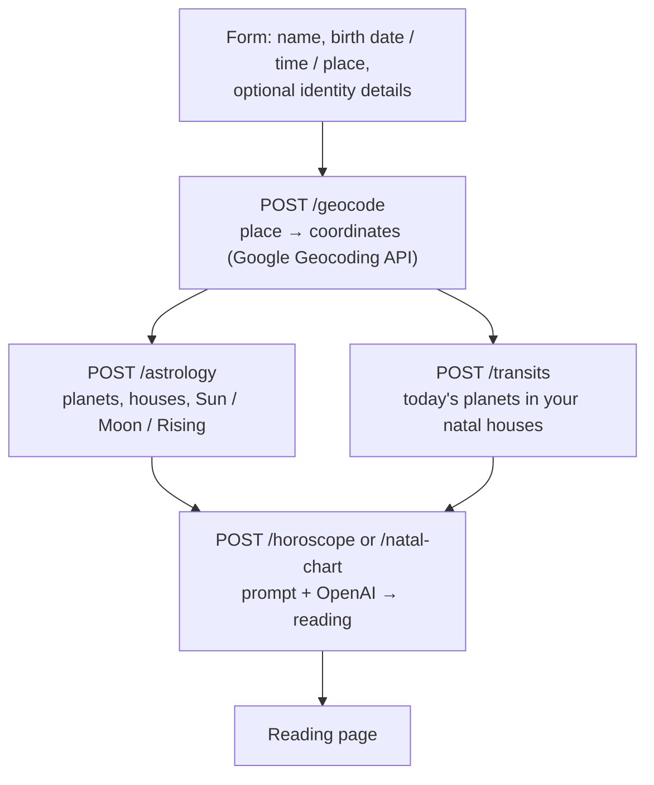

# Astroloqueer

**An experiment in queer astrology and generative AI.**

Astroloqueer generated personalised horoscopes and natal chart readings for queer, trans and gender-diverse people. It combined traditional astrological calculations (done in code, with the Swiss Ephemeris) with a large language model that wrote the interpretation in an affirming, queer-aware voice.

> **Status: the experiment is over.** The service is no longer running and no longer generates horoscopes. The code stays public for anyone who wants to see how it worked, learn from it, or take the idea somewhere new. The [homepage repository](https://github.com/alisits/astroloqueer-homepage) has the short story behind it.

| Daily horoscope | Natal chart reading |
| --- | --- |
|  |  |

*Sample output from the app.*

## What it did

1. You entered a name, a birth date, an optional birth time and a birth place. You could also choose a gender identity, pronouns and a sexual orientation. All of that was optional except the name, date and place.
2. The backend turned the place into coordinates and calculated your chart: Sun, Moon and Rising signs, the position of ten planets, and the twelve houses.
3. It also calculated where the planets are *today* and in which of your houses they currently sit (your transits).
4. It handed the chart, the transits and your identity details to a language model with a prompt that asks for a positive, personal reading centred on queer experience.
5. The app showed the result as either a **daily horoscope** or a longer **natal chart reading**.

## How it works



### The calculation (no AI involved)

All astrology maths happens in plain Python, so the language model never has to "work out" a chart. It only interprets numbers it is given.

- **Ephemeris:** [Swiss Ephemeris](https://www.astro.com/swisseph/) through the [`pyswisseph`](https://pypi.org/project/pyswisseph/) package. No ephemeris data files are included in this repository, so the library's built-in fallback is used.
- **Zodiac:** tropical (the library default; no sidereal mode is set).
- **Bodies:** Sun, Moon, Mercury, Venus, Mars, Jupiter, Saturn, Uranus, Neptune and Pluto. No lunar nodes, Chiron or asteroids.
- **Houses:** Placidus, plus the Ascendant and Midheaven.
- **Time zones:** the birth place's time zone is found from its coordinates (`timezonefinder` + `pytz`), so the local birth time is converted to UTC correctly for historical dates too. If no birth time is given, 12:00 local time is assumed, which makes the Moon and the Rising sign unreliable.
- **Transits:** the planets' positions for the current moment are placed into the user's natal houses. The code does **not** calculate aspects (angles between transiting and natal planets), so there is no "strongest aspect" ranking. The prompt gets the planet-to-house list and the model writes around it.

### The AI part

- Provider: OpenAI, through the Responses API. The default model is `gpt-5.1-chat-latest`; the daily horoscope model can be changed with the `OPENAI_MODEL` environment variable. The natal chart reading uses a fixed model name in `openai_service.py`.
- The prompts live in `Backend/api/services/prompt_builder_service.py`. They set the voice (a warm, professional, queer-inclusive astrologer), tell the model how to use pronouns and orientation, and hand it the chart data as JSON.
- What goes into a prompt: the name, the *text* of the birth place, gender identity, pronouns, orientation, and the computed chart and transits. The birth date, birth time and coordinates are not put in the prompt.
- Generated text is not stored by the backend.

### API

The backend is a small Flask app. Every endpoint except `/health` takes JSON via `POST`.

| Endpoint | Purpose |
| --- | --- |
| `GET /health` | Liveness check |
| `/geocode` | Place name → latitude / longitude (Google Geocoding API) |
| `/astronomy` | Julian day and sidereal time for a UTC datetime and location |
| `/astrology` | Planet positions, house cusps and Big Three for a birth date, time and location |
| `/transits` | Today's planets assigned to the natal houses |
| `/horoscope` | Daily horoscope text from chart + transits + identity details |
| `/natal-chart` | Natal chart reading text from the full chart + identity details |

CORS is restricted to an allow-list of origins in `Backend/api/app.py` and `Backend/api/template.yaml`.

## Tech stack

| Part | Tools |
| --- | --- |
| Backend | Python 3.11, Flask, `pyswisseph`, `timezonefinder`, `pytz`, OpenAI Python SDK |
| Backend hosting | AWS Lambda behind an API Gateway HTTP API, deployed with AWS SAM; API keys in AWS Secrets Manager |
| Frontend | React 18, TypeScript, Vite, Tailwind CSS, shadcn/ui, React Router, TanStack Query |
| Frontend hosting | Netlify |

## Repository layout

```text
Backend/
  api/
    app.py               Flask app and all endpoints (also runs on Lambda)
    wsgi_handler.py      Lambda entry point (Mangum)
    template.yaml        AWS SAM template
    samconfig.toml       SAM deploy settings
    DEPLOYMENT.md        Notes on deploying with SAM
    models/              Planet definitions
    services/            Astrology engine, OpenAI, geocoding, prompts
  tests/                 Calculation tests
Frontend/                React + Vite app
netlify.toml             Frontend build configuration
LICENSE                  GNU AGPL-3.0
```

## Running it yourself

You need your own API keys, and every reading costs a model call, so keep an eye on usage.

- an [OpenAI API key](https://platform.openai.com/)
- a [Google Maps Geocoding API key](https://developers.google.com/maps/documentation/geocoding)

**Backend** (Python 3.11):

```sh
cd Backend/api
python -m venv .venv && source .venv/bin/activate   # on Windows: .venv\Scripts\activate
pip install -r requirements.txt
cp .env.example .env                                # then add your two keys
python app.py                                       # serves on http://localhost:5000
```

**Frontend** (Node.js and npm):

```sh
cd Frontend
npm ci
cp .env.example .env                                # points at http://localhost:5000
npm run dev                                         # serves on http://localhost:8080
```

The dev server uses port 8080 because that origin is on the backend's CORS allow-list.

### Deploying your own copy

Before you deploy a fork, change the values that belong to the original project:

- the allowed origins in `Backend/api/app.py` and `Backend/api/template.yaml`
- the API URLs in `netlify.toml`
- the Secrets Manager secret names in `Backend/api/template.yaml` (`AstroloqueerOpenAI`, `AstroloqueerGoogleMaps`) and the stack names in `samconfig.toml`

`Backend/api/DEPLOYMENT.md` has the SAM notes. The frontend reads the backend URL from the `VITE_API_BASE` environment variable at build time.

## Privacy: what happened to the data

The project handled sensitive details (birth data, gender identity, orientation), so here is exactly what the code does. If you fork it, check this against your own deployment and legal situation, including GDPR if you serve people in the EU.

- **No database.** The backend does not store requests or generated readings.
- **Third parties.** The birth place text is sent to Google's Geocoding API. The name, birth place text, gender identity, pronouns, orientation and the computed chart are sent to OpenAI to write the reading.
- **Browser storage.** The form values and the user's details are kept in the browser's `localStorage` / `sessionStorage` so the pages keep working after a refresh. Nothing is sent anywhere for that purpose.
- **Logs.** Backend logs go to the standard Lambda/CloudWatch logs. At the default `INFO` level the services log derived values such as the birth time in UTC, coordinates and computed house cusps. Set `LOG_LEVEL=WARNING` to avoid that, or remove those log lines, before running this for real users.
- **No accounts, analytics or ad code** are included in this repository.
- **The in-app privacy policy is not a template to reuse.** `Frontend/src/pages/privacy.tsx` is the policy text of the original website. It describes things (Google Analytics, AdSense, a cookie-consent banner) that are not implemented in this code. Anyone running a fork needs to write their own policy that matches what their deployment actually does.

## Known limitations

- Tropical zodiac, ten bodies, Placidus houses only; no aspects, no synastry, no progressions.
- Transits are a snapshot of "now"; there is no forecast over days or weeks.
- Geocoding uses the first result Google returns, so ambiguous place names can resolve to the wrong city.
- No authentication or rate limiting; the only protection against abuse is the CORS allow-list and the Lambda timeout.
- Some explanatory text in the frontend pages describes the readings more generously than the code above (for example, it mentions aspects). Treat this README as the accurate description.
- `Backend/api/tests/` and `Backend/api/README.md` are unmodified AWS SAM boilerplate that refers to a `hello_world` function that no longer exists.

## Tests

The calculation tests live in `Backend/tests/`. For example, from `Backend`:

```sh
PYTHONPATH=api python tests/test_refactoring_calculations_unchanged.py -v
```

They use fixed example birth data and check that the astrology pipeline is deterministic and consistent. Some files in that folder are older manual scripts rather than automated tests.

## License

Released under the **GNU Affero General Public License v3.0**, see [LICENSE](LICENSE). The Swiss Ephemeris, which does the astronomical calculations, is itself offered under AGPL-3.0 (or a commercial licence). If you run a modified version of this project as a network service, the AGPL requires you to offer its source code to the people using it.
